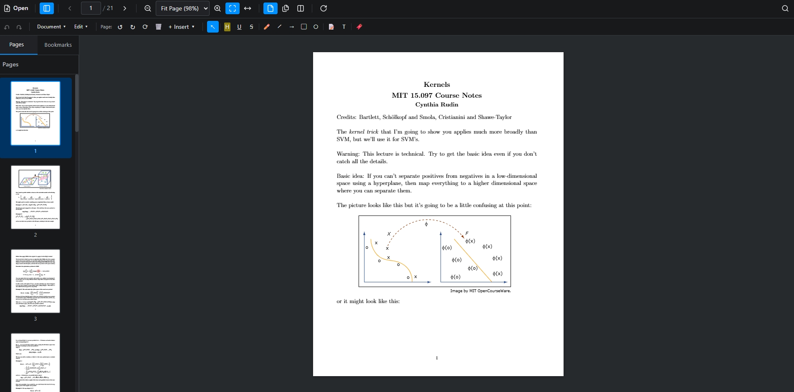
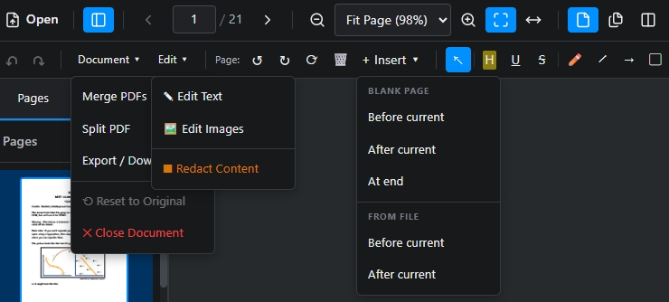

[中文介绍](README_zh.md)

**PDF-Editor** is a free, open-source PDF editor for your browser. View, edit, annotate, and organize PDFs locally without uploading your files. Switch between English and Chinese instantly.

<div align="center">
  
  
</div>

## Features

- **📄 Viewing & Navigation**: Browse PDFs with thumbnails, bookmarks, search, and flexible page views.
- **✏️ Text & Image Editing**: Format original text, arrange objects, crop and transform images, or insert new content.
- **🖊️ Annotations & Signatures**: Highlight, draw, add notes, and place handwritten or image signatures.
- **🔗 Page Organization**: Merge, split, insert, delete, rotate, and reorder pages.
- **🖼️ PDF & Images**: Create PDFs from images, or export selected PDF pages as PNG/JPEG.
- **📝 Forms**: Create and fill PDF forms, import/export data, and flatten fields.
- **🔍 Scan OCR**: Make English and Simplified Chinese scans searchable with local recognition.
- **🔒 Private & Open Source**: Process documents locally, without subscriptions or cloud uploads.

## Quick Start

Requires [Node.js](https://nodejs.org/) 20.19+ (20.x) or 22.12+, and npm.

```bash
git clone https://github.com/JhuoW/PDF-Editor.git
cd PDF-Editor
npm ci
npm run dev
```

Open `http://localhost:5173` in your browser.

### Basic Usage

1. **Open**: Click **Open** or drag a PDF into the viewer.
2. **Navigate**: Use thumbnails, page controls, and zoom to browse the document.
3. **Edit & Annotate**: Use **Edit objects** to move text and resize images, or **Edit text** to change the original wording. Add annotations from the toolbar.
4. **Organize**: Use the page tools to merge, split, rotate, or reorder pages.
5. **Export**: Download your edited PDF with **Export**, or use **Convert → PDF to images** for selected pages.

## Contributing

Bug reports, feature requests, and pull requests are welcome. Start with an [issue](https://github.com/JhuoW/PDF-Editor/issues).

## Development checks

```bash
npm run build
npm run test:run
npx playwright install chromium
npm run test:e2e
npm run lint
npm run check:i18n
npm run audit:dependencies
```

### Static deployment

Deploy the entire `dist/` directory after `npm run build`. For a subdirectory:

```bash
npm run build -- --base=/pdf-editor/
```

Keep all bundled assets and license files. PDF-Editor and MuPDF use [AGPL-3.0](LICENSE); bundled Tesseract.js components and language data use Apache-2.0.
