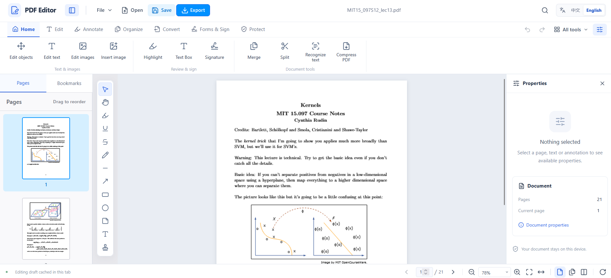
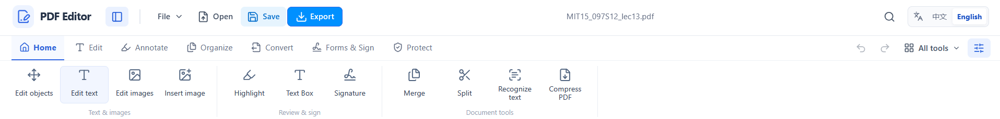
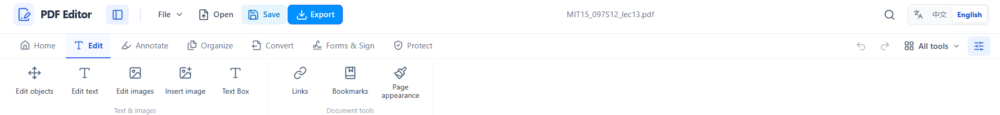
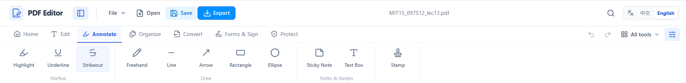
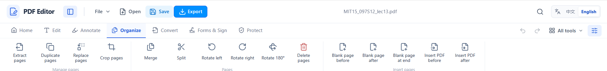

[English](README.md)

**PDF-Editor** 是免费、开源的浏览器端 PDF 编辑器，可在本地阅读、编辑、批注和整理 PDF，无需上传文件，支持即时中英文切换。

<p align="center">
  <a href="docs/imgs/new_example_1.png"></a>
</p>

<p align="center">
  <strong>主页 · 编辑 · 注释 · 页面管理</strong><br /><br />
  <a href="docs/imgs/new_example_2.png"></a><br /><br />
  <a href="docs/imgs/new_example_3.png"></a><br /><br />
  <a href="docs/imgs/new_example_4.png"></a><br /><br />
  <a href="docs/imgs/new_example_5.png"></a>
</p>

## 功能特性

- **📄 阅读与导航**：通过缩略图、书签、搜索和多种页面视图浏览 PDF。
- **✏️ 文字与图片编辑**：调整原文格式、编排对象、裁剪和变换图片，或插入新内容。
- **🖊️ 批注与签名**：高亮、绘图、添加便签，以及放置手写或图片签名。
- **🔗 页面整理**：提取、复制、替换、裁剪、合并、拆分和重排页面。
- **🖼️ PDF 与图片**：图片生成 PDF，或将指定 PDF 页面导出为 PNG/JPEG 图片。
- **📝 表单**：创建和填写 PDF 表单，导入导出数据，以及扁平化字段。
- **🔍 扫描识别**：本地识别英文和简体中文扫描文档，使其文字可搜索。
- **🔒 隐私与开源**：所有文档处理在本地完成，无需订阅或上传云端。

## 快速开始

**推荐方式：** 直接访问 [PDF-Editor 在线版](https://wei2hu0.github.io/PDF-Editor/)，无需安装。

### 基本使用

1. **打开**：点击 **打开**，或将 PDF 拖入查看器。
2. **浏览**：使用缩略图、页面控件和缩放功能浏览文档。
3. **编辑与批注**：使用 **编辑对象** 移动文字、缩放图片，使用 **编辑文本** 修改原文；通过工具栏添加批注。
4. **整理**：合并、拆分、旋转或重排页面；裁剪时画出选区，按 **Enter** 或点击 **确认裁剪**。
5. **保存**：点击 **保存** 或 **文件 → 另存为…**；使用 **格式转换 → PDF 转图片** 导出指定页面图片。

### 本地构建（可选）

需要 [Node.js](https://nodejs.org/) 20.19+（20.x 系列）或 22.12+，以及 npm。

```bash
git clone https://github.com/JhuoW/PDF-Editor.git
cd PDF-Editor
npm ci
npm run build
npm run preview
```

在浏览器中打开 `http://localhost:4173`。开发时可使用 `npm run dev`。

## 参与贡献

欢迎反馈问题、提出功能建议或提交 Pull Request，可从提交 [issue](https://github.com/JhuoW/PDF-Editor/issues) 开始。

## 开发检查

```bash
npm run build
npm run test:run
npx playwright install chromium
npm run test:e2e
npm run lint
npm run check:i18n
npm run audit:dependencies
```

### 静态部署

运行 `npm run build` 后部署整个 `dist/` 目录。部署到子路径时：

```bash
npm run build -- --base=/pdf-editor/
```

保留所有附带资源和许可文件。PDF-Editor 与 MuPDF 使用 [AGPL-3.0](LICENSE)；附带的 Tesseract.js 组件和语言数据使用 Apache-2.0。
